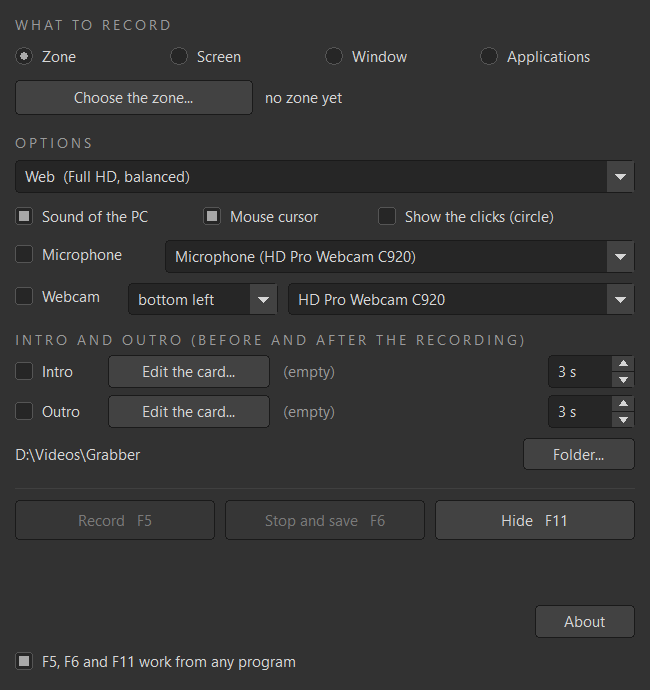

<p align="center"></p>

<p align="center">Grabber is cool :)</p>

# Grabber

A small screen video capture tool for Windows. It records a zone, a whole screen, a window or a set of applications into an MP4 (H.264), with the sound of the PC and, if you want, your microphone.

Part of the tools of [bsm3d.com](https://www.bsm3d.com).



## Download

Get the latest version on the [Releases page](https://github.com/bsm3d/Grabber/releases/latest):

- `Grabber-x.y.z-Setup.exe`: the installer (per user by default, no administrator rights needed).
- `Grabber-x.y.z-portable.zip`: unzip and run `Grabber.exe`, nothing to install.

ffmpeg is included in both. Windows 10 or later, 64 bit.

## Use

| Key | Action |
| --- | --- |
| F5 | Start the recording |
| F6 | Stop and save (the MP4 goes to the folder shown in the window, `Videos\Grabber` by default) |
| F11 | Hide or show the tool (it is never in the recording) |

The three keys work from any program, so the tool can be hidden while you record. If another program already uses one of them, untick "F5, F6 and F11 work from any program": the keys then work only when the window is in front.

## Features

- **What to record**: a zone you drag on the screen, a whole screen, a window, or several applications at once (the video shows the program in front and black while something else is in front, so the desktop is never in the video).
- **Compression**: Streaming (light file), Web (balanced) or Full HD (best quality). All record at 30 images per second, at 1920 x 1080 at most (a bigger picture is shrunk to fit, never enlarged).
- **Sound**: the sound of the PC, and optionally your microphone, mixed together. With speakers the microphone can pick up the PC sound: use headphones.
- **Webcam**: shown small in the corner of your choice, 10 pixels from the edges.
- **Show the clicks**: a circle opens where the mouse is clicked (yellow for the left button, blue for the right one).
- **Intro and outro**: a text or an image, 1 to 15 seconds, before and after the recording.
- **Encoding**: automatic. The graphics card is used when it can (NVIDIA, Intel, AMD or the Windows encoder), the processor otherwise, and it takes over by itself if the graphics card fails.

A window is recorded as its rectangle on the screen, brought to the front when the recording starts: it must stay where it is, and nothing should be put in front of it.

## Settings

Settings are kept in `%APPDATA%\BSM\Grabber\settings.ini`. The saved intro and outro cards are in `presets.json` beside it. Your videos are never touched by the uninstaller.

## Build

Needs MinGW-w64 (MSYS2 ucrt64) and `ffmpeg.exe`. Inno Setup 6 is needed only for the installer.

```powershell
powershell -File build.ps1            # Grabber.exe, then dist\Grabber
powershell -File build.ps1 -Package   # the same, then the portable zip and the installer
powershell -File build.ps1 -Syntax    # only checks that the sources compile
```

Environment variables: `GRABBER_MINGW` (MinGW folder, default `C:\msys64\ucrt64\bin`), `GRABBER_FFMPEG` (path of `ffmpeg.exe`), `BSM_DISTRIBUTIONS` (output folder of the installer and the zip).

End to end checks: `powershell -File tests\e2e.ps1` (needs Python with PySide6 for the test windows, `GRABBER_TEST_PYTHON` or `python` on the PATH).

## Licence

Grabber, © Benoit Saint-Moulin. Free to use, all rights reserved on the source code, no warranty. See [LICENSE.txt](LICENSE.txt). ffmpeg keeps its own licence, see [FFMPEG-LICENSE.txt](FFMPEG-LICENSE.txt).
